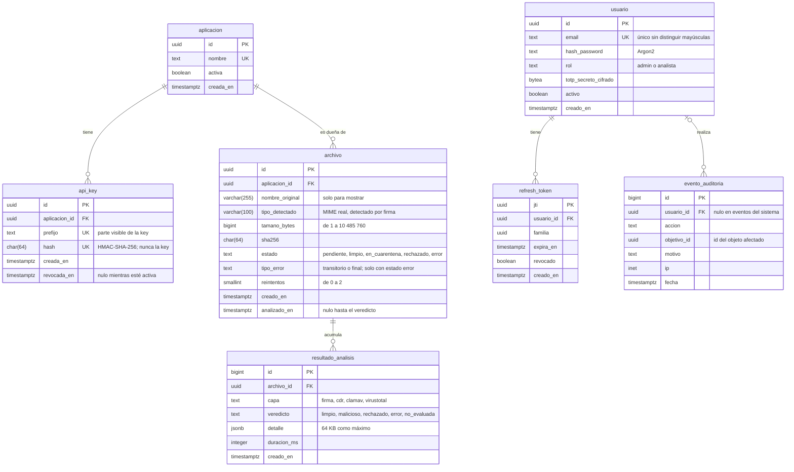

# Gatekeeper

API intermediaria que valida, sanea y analiza los archivos que suben los usuarios finales antes de que lleguen a la
aplicación cliente. Acepta JPEG, PNG y PDF de hasta 10 MiB, y la aplicación cliente solo descarga la versión
reconstruida del archivo, nunca el original.

## Estado

El proyecto está en construcción: **todavía no se puede subir ni analizar ningún archivo.**

| Parte | Estado |
|---|---|
| Modelo de datos | `aplicacion` y `api_key` tienen modelo ORM y pruebas; falta la primera migración con Alembic |
| API | Esqueleto de FastAPI con `/health` y headers de seguridad; todavía sin endpoints de archivos |
| Rebanada vertical | En curso: subir un archivo, consultar su estado y descargar la versión reconstruida |

## Cómo funciona

1. La aplicación cliente sube el archivo con su API key. La API lo recibe en streaming, calcula su SHA-256, lo guarda
   con un UUID generado por el servidor y responde `202` con el id.
2. El `worker` comprueba el tipo real con python-magic, reconstruye el archivo (CDR) y lo analiza con ClamAV. Corre sin
   internet y sin acceso a la base de datos.
3. El servicio `reputation` consulta VirusTotal solo por hash. Nunca envía el archivo.
4. El `coordinator` combina los resultados y decide el estado final: `limpio`, `en_cuarentena`, `rechazado` o `error`.
5. La aplicación cliente consulta el estado y descarga la versión reconstruida cuando el archivo queda `limpio`.

## Modelo de datos

El diagrama muestra el modelo completo diseñado sobre PostgreSQL 16. La tabla de abajo indica qué parte ya existe.



| Tablas | Estado |
|---|---|
| `aplicacion`, `api_key` | Modelo ORM y pruebas |
| `archivo`, `resultado_analisis` | Diseñadas; llegan con la rebanada vertical |
| `usuario`, `refresh_token`, `evento_auditoria` | Diseñadas; llegan con el dashboard de administración |

Reglas del modelo:

- Las claves son UUID generados por el servidor, salvo en `resultado_analisis` y `evento_auditoria`, que usan `bigint`.
- Todas las fechas son `timestamptz`.
- Toda consulta de un archivo se filtra por `aplicacion_id`: una aplicación nunca ve los archivos de otra.
- `evento_auditoria` es de solo inserción. Dos triggers impiden modificarla o vaciarla.

## Desarrollo

Requisitos: Python 3.12, [uv](https://docs.astral.sh/uv/) y Docker.

```bash
uv sync
uv run pytest
```

Las pruebas de la base de datos levantan un PostgreSQL 16 desechable en Docker. Si Docker no responde, esas pruebas
fallan.

## Limitaciones

- Solo se aceptan JPEG, PNG y PDF. SVG, ZIP, Office y el análisis semántico quedan fuera del alcance.
- La rebanada vertical es solo para uso local. No incluye ClamAV, VirusTotal, Redis ni dashboard, y el CDR corre en un
  proceso hijo limitado en lugar de un worker en contenedor aislado. No debe usarse en producción.
