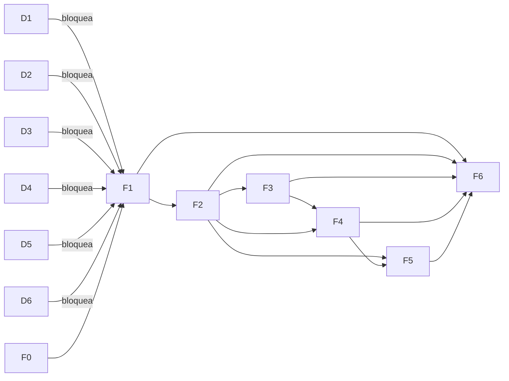
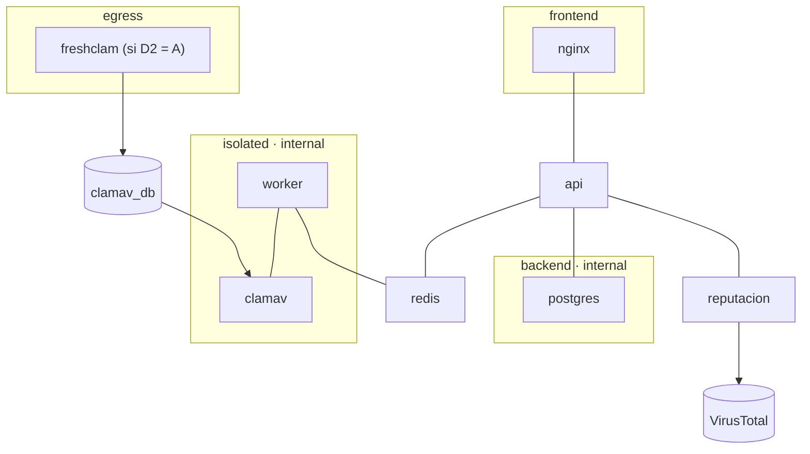

# Gatekeeper — Knowledge Graph

`gatekeeper_kg.json` es la **base de trabajo** del proyecto. Se generó el 2026-10-28 a partir de
`gatekeeper_contexto.json` v1.0.0 y `gatekeeper_plan.json` v1.0.0. Desde ahora, el estado de fases, pasos,
decisiones, vectores y observaciones se actualiza en el KG.

- **377 nodos, 820 aristas, 39 tipos de nodo.** Sin aristas rotas ni nodos huérfanos.
- Formato: `{ meta, nodos: [{id, tipo, label, props}], aristas: [{de, rel, a, props?}] }`.
- Los ids originales se conservan (`O1`, `INV-04`, `V07`, `D2`, `F3`, `F3.04`, `R1`, `CHK1`). Los demás llevan
  prefijo por tipo: `svc:`, `red:`, `vol:`, `ep:`, `ent:`, `estado:`, `vec:`, `vecx:`, `ctrl:`, `tec:`,
  `param:`, `lim:`, `auth:`, `http:`, `dir:`, `entg:`, `skill:`, `patron:`, `flujo:`.

## Cadena principal

```
Objetivo ─cumple─ Fase ─contiene─ Paso ─implementa→ Control ←detenido_por─ VectorPrueba ─ejercita→ CWE
                   │                │                  │
              depende_de     hace_cumplir→ Invariante  implementado_en→ Servicio ─conectado_a→ Red
                             verificado_en→ Verificacion (V##) ←resuelve─ Decision (D#) ─bloquea→ F1
```

## Fases y bloqueos



| Fase | Cumple | Vectores que deben pasar desde aquí |
|---|---|---|
| F0 Preparación | — | — |
| F1 Arquitectura y base en contenedores | O1, inicio de O2 | — |
| F2 Recepción y validación | O2, O3 | 1, 2, 3, 6, 7, 8, 10, 13, 14, 15 |
| F3 Reconstrucción (CDR) | O4 | 4, 5, 9 + 3 adicionales |
| F4 Antimalware en dos capas | O5 | 11 + no envío a VT |
| F5 Dashboard de SecOps | O6 | 12 + RBAC + refresh reutilizado |
| F6 Validación y auditoría | O7 | los 15 |

## Arquitectura (redes de F1.02)



## Observaciones nuevas (K01–K06)

Se detectaron al cruzar las relaciones del grafo. **Ninguna está aprobada**: se deciden junto con D1–D6 en F0.01.

| Id | Hallazgo | Propuesta | Severidad |
|---|---|---|---|
| K01 | Ningún componente consolida los veredictos: el worker no puede hablar con `reputacion` (redes distintas) ni escribir en PostgreSQL (F1.05). | La API orquesta los dos jobs ARQ y una sola función de decisión aplica la prioridad y el fail-closed. | media |
| K02 | Redis está en `isolated` junto al worker y guarda la caché de VT y el rate limit: un worker comprometido podría envenenarlos. | ACLs de Redis por usuario o una instancia aparte para la cola; la API valida el resultado contra el job. | media |
| K03 | Faltan las transiciones `error → pendiente` (reintento) y `en_cuarentena → rechazado/error` (si falla el CDR tras liberar). | Agregarlas a D4. | baja |
| K04 | El servicio se llama `reputacion` en el contexto y `reputation` en el plan. | `reputation` en código y Compose. | baja |
| K05 | Ningún endpoint da de alta aplicaciones, aunque INV-10 depende de ellas. | `POST /v1/admin/api-keys` recibe `aplicacion_id`. | baja |
| K06 | No se define si admin hereda los permisos de analista. | admin ⊇ analista en RBAC. | baja |

## Cómo se usa

- **Antes de un paso:** revisar sus vecinos (`hace_cumplir`, `verificado_en`, `usa_parametro`, `implementa`) y los
  vectores del control que implementa.
- **Al terminar un paso:** cambiar `props.estado` a `hecho`. Una decisión se registra con `props.eleccion` y
  `estado: confirmada` en el nodo `D#` o `K##`, y también en `docs/decisiones.md`.
- **Elementos nuevos:** se agregan como nodos y aristas siguiendo los mismos prefijos. `meta.conteos` se recalcula.
