# Reporte Final del Proyecto: Gatekeeper

API intermediaria que valida, sanea y analiza los archivos que suben los usuarios antes de que lleguen a la aplicación cliente. La guía de operación (uso local, despliegue, actualización y rollback) está en [`OPERACION.md`](https://github.com/Rust7730/GateKeeper-API/blob/main/OPERACION.md). El dashboard SecOps y la landing viven en [GateKeeper-Frontend](https://github.com/Rust7730/GateKeeper-Frontend).

## Ficha de Identificación

- **Institución:** Universidad Politécnica de Chiapas
- **Carrera / Programa:** Ingeniería en Tecnologías de la Información e Innovación Digital
- **Asignatura:** Seguridad Informática
- **Profesor:** M.C. José Alonso Macías Montoya
- **Fecha de Entrega:** 23/11/2026
- **Nombre del Equipo / Grupo:** Grupo 7B
- **Nombre del Proyecto:** Gatekeeper — API intermediaria de validación, desarme y reconstrucción (CDR), análisis antimalware multicapa y consola SecOps

### Integrantes del Equipo

| Nombre Completo | Matrícula | Correo Electrónico | Rol / Enfoque Principal |
| --- | --- | --- | --- |
| Luvia Magali Hidalgo García | 243732 | `243732@ids.upchiapas.edu.mx` | Frontend & UI/UX, Documentación y Pruebas |
| Rodolfo Ramírez Reyes | 423768 | `423768@ids.upchiapas.edu.mx` | Arquitectura, Backend API, Seguridad & DevOps |

---

## Sección I: Control de Acceso y Enlaces del Proyecto

| Recurso | Enlace / Estado | Notas de Acceso |
| --- | --- | --- |
| **Repositorio Backend (API, CDR, Worker, Infraestructura)** | `https://github.com/Rust7730/GateKeeper-API` | Público (rama principal `main`) |
| **Repositorio Frontend (Dashboard SecOps + Landing Page)** | `https://github.com/Rust7730/GateKeeper-Frontend` | Público (ramas `main`, `dist-main`, `dist-landing`) |
| **Aplicación Web / Dashboard SecOps + API en Producción** | `https://35-168-228-65.sslip.io/` | AWS EC2 `t3.medium` con HTTPS (Let's Encrypt). Healthcheck público en `/health`. |
| **Landing Page Pública (Despliegue Aislado)** | `https://34-231-193-98.sslip.io/` | AWS EC2 `t3.micro` aislada con HTTPS (ES: `/`, EN: `/en/`) |
| **Aplicación Cliente Demo (Consumidor B2B "Lumina")** | `https://github.com/Rust7730/GateKeeper-API/tree/main/demo-client-app` | Monolito de gastos y reembolsos (`http://127.0.0.1:8090`) que consume `/v1/files` |
| **Demostración Interactiva en Vivo** | `https://34-231-193-98.sslip.io/` y `https://35-168-228-65.sslip.io/` | Recorrido interactivo del pipeline CDR y consola SecOps en producción |
| **Video Demostrativo (3-5 min)** | `https://drive.google.com/drive/folders/16Ys7HROi5H-qMxPC49XXrihD43gPpAxh?usp=drive_link` | Google Drive (acceso público) |

---

## Sección II: Declaración de Licencia de Software

### 2.1 Tipo de Licencia Seleccionada

- **Licencia Elegida:** Licencia MIT (*MIT License*). El archivo [`LICENSE`](https://github.com/Rust7730/GateKeeper-API/blob/main/LICENSE) está en la raíz del repositorio.

### 2.2 Justificación de la Licencia

Se seleccionó la **Licencia MIT** debido a que es una licencia permisiva ampliamente adoptada en la industria de software y ciberseguridad que permite a la comunidad académica, auditores y desarrolladores inspeccionar, reutilizar, modificar y distribuir tanto la API de validación/CDR como el panel SecOps sin restricciones comerciales, manteniendo únicamente el aviso de derechos de autor y la exención de responsabilidad.


---

## Sección III: Resumen Ejecutivo y Planteamiento

### 3.1 Descripción del Proyecto

**Gatekeeper** es una plataforma integral de seguridad para la ingesta de archivos en aplicaciones web, compuesta por cuatro componentes desacoplados:

1. **API RESTful Intermediaria y Pipeline de Seguridad (`GateKeeper-API`):** Se coloca entre los usuarios finales y las aplicaciones cliente. Recibe archivos en *streaming* (hasta 10 MiB), valida su tipo real mediante firma mágica (`python-magic`), los analiza de forma asíncrona con **ClamAV** (antivirus en memoria vía `zINSTREAM`) y **VirusTotal** (consulta exclusiva por hash SHA-256 sin exfiltrar archivos), y reconstruye desde cero los documentos permitidos (**PDF, PNG y JPEG**) mediante un motor **CDR (*Content Disarm and Reconstruction*)** ejecutado en un subproceso aislado con **Landlock**, **seccomp-bpf** y límites estrictos de memoria/CPU. La aplicación cliente **nunca recibe el archivo original**, únicamente la copia reconstruida y libre de contenido activo.
2. **Dashboard SecOps Web (`GateKeeper-Frontend`):** Aplicación web SPA construida en **Angular 22** (modo *zoneless* con Signals y Angular Material) para operadores con control de acceso basado en roles (**RBAC**: `admin` y `analista`), autenticación reforzada con **Argon2id + JWT + TOTP (2FA)**, monitoreo en tiempo real por **Server-Sent Events (SSE)**, gestión de cuarentena con liberación auditada, administración de API Keys y consola interactiva de pruebas.
3. **Sitio Público / Landing Page (`landing/`):** Sitio estático bilingüe (español e inglés) desarrollado en **Astro 5** y desplegado en una instancia EC2 `micro` independiente con actualización automática por *pull*.
4. **Aplicación Cliente Consumidora de Demostración (`demo-client-app/`):** Monolito web independiente (**Lumina · Gastos y Reembolsos**) que simula un sistema corporativo real consumiendo la API `/v1/files` para demostrar de extremo a extremo la aprobación de comprobantes sanitizados y el bloqueo de archivos maliciosos o falsificados.

### 3.2 Planteamiento del Problema y Justificación

La recepción de archivos subidos por usuarios (facturas PDF, identificaciones, fotografías de comprobantes) constituye uno de los vectores de ataque más críticos y frecuentes en aplicaciones web modernas:

- **Falsificación de tipo y doble extensión:** Atacantes suben scripts ejecutables (`PHP`, `ELF`, `HTML/JS`, `SVG`) renombrados como `.jpg` o `.pdf` para lograr ejecución remota de código (RCE) o Cross-Site Scripting almacenado (XSS).
- **Archivos políglotas y contenido activo oculto:** Un archivo puede ser simultáneamente una imagen válida y un payload ejecutable, o un PDF legítimo con `/JavaScript`, `/OpenAction`, `/Launch` o archivos embebidos maliciosos.
- **Ataques de denegación de servicio (DoS) por descompresión:** Imágenes de miles de megapíxeles (*pixel bombs*) o flujos `FlateDecode` comprimidos en PDF (*zip/flate bombs*) pueden agotar la RAM de un servidor en milisegundos.
- **Fuga de metadatos sensibles y exposición entre clientes:** Metadatos EXIF/GPS/XMP incrustados en fotos y fallos de autorización (IDOR) que permiten a una aplicación acceder a documentos de otra.

Confiar únicamente en validar la extensión del archivo o el encabezado `Content-Type` es trivialmente evadible. **Gatekeeper** resuelve esta problemática aplicando **defensa en profundidad** regida por **10 invariantes de seguridad inviolables** (como *fail-closed*: ningún error puede terminar en estado `limpio`, aislamiento estricto multi-aplicación y reconstrucción obligatoria CDR antes de cualquier entrega).

### 3.3 Matriz de Cumplimiento de Objetivos

| Objetivo Inicial Planteado | Estado de Implementación | Observaciones / Alcance Logrado |
| --- | --- | --- |
| **General:** Diseñar, implementar, auditar y desplegar una API intermediaria de validación, análisis antimalware y desarme CDR de archivos con panel SecOps, garantizando latencia baja y principio *fail-closed*. | **Completado** | Sistema operativo en producción sobre AWS EC2 con HTTPS (Let's Encrypt), 11 contenedores endurecidos, Dashboard SecOps y Landing aislada. |
| **Específico 1:** Diseñar la arquitectura segmentada, base de datos relacional y API RESTful de ingesta, consulta, descarga y administración. | **Completado** | API RESTful en FastAPI con **22 endpoints** (`/v1/files`, `/v1/auth`, `/v1/admin`, `/health`), esquema PostgreSQL 16 con migraciones Alembic y 2 colas Redis/ARQ aisladas. |
| **Específico 2:** Implementar el motor CDR para imágenes (JPEG/PNG) y PDF junto con análisis antimalware multicapa (ClamAV + reputación por hash) en aislamiento fuerte. | **Completado** | Recodificación completa de imágenes con Pillow (tope 40 MP) y reconstrucción de PDF con `pikepdf` (tope 200 páginas / 100 MB de descompresión) dentro de subprocesos con Landlock, seccomp-bpf y `RLIMIT_AS`. Integración real con ClamAV (`zINSTREAM`) y VirusTotal (solo SHA-256). |
| **Específico 3:** Desarrollar el Dashboard SecOps Web, la Landing Page pública y un cliente consumidor real para demostración. | **Completado** | Dashboard en Angular 22 con login + TOTP (2FA), SSE en vivo, gestión de cuarentena y API Keys; Landing Astro 5 desplegada aparte; app cliente *Lumina* funcionando contra la API en producción. |
| **Específico 4:** Ejecutar pruebas de seguridad ofensiva (matriz de ataques), análisis estático (SAST), escaneo dinámico (DAST) y escaneo de contenedores, remediando todos los hallazgos críticos y altos. | **Completado** | **526 pruebas** en `tests/attack-matrix/` aprobadas + **98 pruebas** de regresión de endurecimiento; Bandit (`0 High / 0 Medium`); OWASP ZAP (`119 PASS, 0 FAIL`); Trivy (`0` CVEs corregibles); 1 hallazgo Crítico y 8 Altos remediados. |

---

## Sección IV: Arquitectura Técnica y Stack Tecnológico

### 4.1 Stack Tecnológico

- **Frontend (Dashboard SecOps & Landing):**
  - Dashboard: **Angular 22** (zoneless, Signals), TypeScript 6, Angular Material, ECharts 6, RxJS, Vitest (87 pruebas unitarias aprobadas), ESLint, Stylelint.
  - Landing Page: **Astro 5** (generación estática bilingüe ES/EN).
  - App Cliente Demo (*Lumina*): HTML5/CSS3/JS + FastAPI.
- **Backend & API:** **Python 3.12**, **FastAPI 0.162**, **Uvicorn**, **ARQ 0.25** (workers asíncronos), **HTTPX**.
- **Base de Datos y Colas:** **PostgreSQL 16** (con SQLAlchemy 2.0 async, `psycopg 3` y Alembic, operando con rol de privilegios mínimos `gk_app`) y **Redis 7** (dos instancias aisladas: `redis-main` para colas/rate-limiting/SSE y `redis-worker` para tráfico aislado hacia el worker CDR).
- **Motor Antimalware y CDR:** **ClamAV + Freshclam**, **VirusTotal API v3** (consulta exclusiva por SHA-256), **Pillow 13** (CDR imágenes), **pikepdf 10 / QPDF** (CDR PDF), **python-magic** (detección real por firma binaria).
- **Infraestructura, Contenedores y CI/CD:** **AWS EC2** (Ubuntu 24.04 LTS: instancia `t3.medium` para API/Dashboard y `t3.micro` aislada para Landing), **Docker Compose** (11 servicios endurecidos con `read_only: true`, `cap_drop: [ALL]`, `no-new-privileges`), **Nginx** (TLS 1.2/1.3 con Let's Encrypt / Certbot), **GitHub Actions + GHCR** y actualización automática pull-based mediante timers de **systemd**.
- **Librerías de Seguridad / Cifrado:** **Argon2-cffi** (Argon2id para contraseñas), **PyJWT** (tokens JWT firmados con rotación de refresh tokens), **PyOTP** (TOTP RFC 6238 con protección anti-replay en Redis), **cryptography** (cifrado de secretos TOTP en reposo), **HMAC-SHA-256** con *pepper* (almacenamiento de API Keys), **Landlock LSM** y **seccomp-bpf**.

### 4.2 Diagramas de Arquitectura, Flujo CDR y Máquina de Estados (Mermaid)

#### A) Arquitectura General e Infraestructura Aislada (AWS EC2 + Docker)

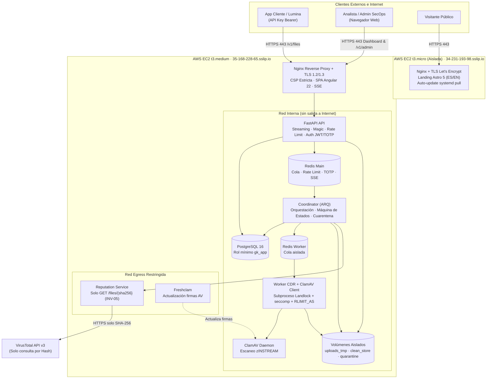

#### B) Secuencia de Ingesta, Análisis Antimalware y Desarme CDR

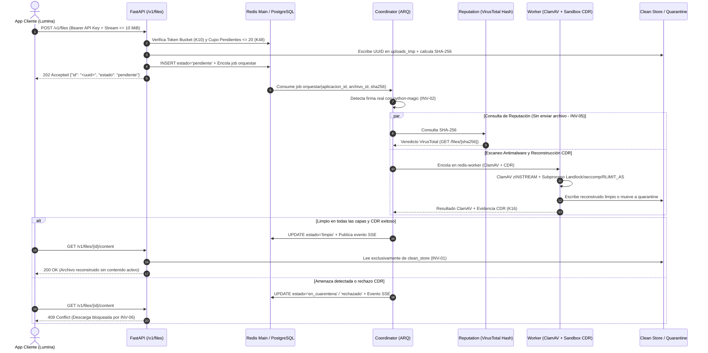

#### C) Máquina de Estados de un Archivo (`INV-01`, `INV-06`, `INV-09`)

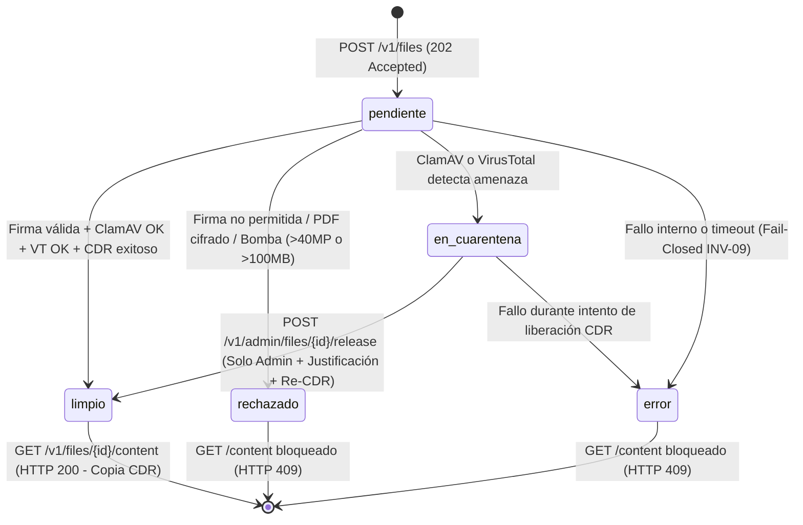

### 4.3 Especificación de Endpoints Principales de la API

Todos los endpoints fueron exportados y verificados contra la especificación OpenAPI (`api/openapi.json`, 22 operaciones registradas):

| Método HTTP | Ruta / Endpoint | Descripción | Requiere Autenticación |
| --- | --- | --- | --- |
| `GET` | `/health` | Verificación de estado de salud del servicio (`status: ok`) | NO |
| `POST` | `/v1/files` | Recepción en *streaming* (hasta 10 MiB), cálculo SHA-256 y encolado asíncrono (`202 Accepted`) | SÍ (API Key `Bearer`) |
| `GET` | `/v1/files/{archivo_id}` | Consulta de estado, tipo detectado, tamaño, hash y marcas de tiempo del archivo propio | SÍ (API Key `Bearer`) |
| `GET` | `/v1/files/{archivo_id}/content` | Descarga exclusiva de la copia reconstruida por CDR (solo en estado `limpio`; otros estados responden `409`) | SÍ (API Key `Bearer`) |
| `POST` | `/v1/auth/login` | Autenticación de operador con correo y contraseña (Argon2id); emite desafío MFA o sesión | NO (Rate Limited) |
| `POST` | `/v1/auth/totp` | Verificación de código TOTP (RFC 6238) con protección anti-replay; emite JWT + cookies `HttpOnly` | NO (Requiere `desafio_id`) |
| `POST` | `/v1/auth/totp/enroll` | Genera secreto TOTP temporal en Redis y URI `otpauth://` (bloqueado si MFA ya está activo) | SÍ (JWT Sesión) |
| `POST` | `/v1/auth/totp/confirm` | Valida primer código TOTP antes de persistir el secreto cifrado en BD y registrar auditoría | SÍ (JWT Sesión) |
| `POST` | `/v1/auth/refresh` | Rotación de *refresh token* con detección de reuso (revoca familia de tokens) y cabecera CSRF | SÍ (Cookie `refresh` + CSRF) |
| `POST` | `/v1/auth/logout` | Revocación de sesión activa y limpieza de cookies de autenticación | SÍ (Cookie `refresh` + CSRF) |
| `GET` | `/v1/auth/me` | Información del operador autenticado (id, correo, rol, estado MFA) | SÍ (JWT Bearer) |
| `GET` | `/v1/auth/admin-check` | Verificación explícita de privilegios administrativos | SÍ (JWT Rol `admin`) |
| `GET` | `/v1/admin/files` | Listado paginado de archivos procesados con búsqueda anti-oráculo (`q`) y filtros por estado | SÍ (JWT `admin`/`analista`) |
| `GET` | `/v1/admin/files/{archivo_id}` | Detalle completo de análisis (capas ClamAV, VirusTotal, CDR y metadatos) | SÍ (JWT `admin`/`analista`) |
| `POST` | `/v1/admin/files/{archivo_id}/release` | Liberación controlada de cuarentena (exige justificación 20–500 caracteres, re-ejecuta CDR y registra auditoría) | SÍ (JWT Rol `admin`) |
| `GET` | `/v1/admin/metrics` | Métricas agregadas de ingesta, tasa de bloqueo, cuarentena y latencia | SÍ (JWT `admin`/`analista`) |
| `GET` | `/v1/admin/audit` | Consulta de bitácora inmutable de eventos de seguridad y acciones administrativas | SÍ (JWT Rol `admin`) |
| `GET` | `/v1/admin/events` | Flujo en tiempo real (*Server-Sent Events*) con corte automático al expirar el JWT | SÍ (JWT `admin`/`analista`) |
| `GET` | `/v1/admin/applications` | Listado de aplicaciones cliente registradas | SÍ (JWT `admin`/`analista`) |
| `GET` | `/v1/admin/api-keys` | Listado de API Keys emitidas (solo prefijo y metadatos, nunca el secreto en claro) | SÍ (JWT Rol `admin`) |
| `POST` | `/v1/admin/api-keys` | Generación de nueva API Key (`gk_live_...`), almacenada solo como HMAC-SHA-256 con *pepper* | SÍ (JWT Rol `admin`) |
| `DELETE` | `/v1/admin/api-keys/{key_id}` | Revocación inmediata de una API Key comprometida o en desuso | SÍ (JWT Rol `admin`) |

---

## Sección V: Matriz de Seguridad y Evidencias de Funcionamiento

### 5.1 Mecanismos de Seguridad Implementados

El diseño de Gatekeeper sigue una arquitectura de **defensa en profundidad** orientada a mitigar OWASP Top 10 (Web y API) y ataques específicos sobre procesamiento de archivos:

1. **Validación estricta en ingesta y prevención de Path Traversal / DoS:**
   - Lectura en *streaming* con tope duro de 10 MiB tanto en Nginx (`client_max_body_size`) como en FastAPI; el nombre original del cliente nunca se usa en el sistema de archivos (almacenamiento exclusivo por UUID del servidor).
   - Identificación obligatoria del tipo MIME por firma binaria real (`python-magic`), ignorando extensión y cabecera `Content-Type`. Lista blanca estricta: `image/jpeg`, `image/png` y `application/pdf`.
   - Protección contra *symlinks* y ataques TOCTOU usando `O_RDONLY | O_NOFOLLOW`, verificación `S_ISREG` y permisos restringidos (`0770` / `0640`).
2. **Desarme y Reconstrucción de Contenido (CDR) en Sandbox de Kernel:**
   - **Imágenes (JPEG/PNG):** Tope de 40 megapíxeles validado antes de decodificar píxeles (`load()`). Re-codificación completa desde los píxeles crudos, eliminando EXIF, GPS, perfiles ICC, comentarios `tEXt`/XMP y datos anexados tras `EOI`/`IEND` (neutralización de políglotas).
   - **PDF:** Validación de tope de 200 páginas y 100 MB de descompresión acumulada (mitigación de bombas `FlateDecode`). Eliminación de `/JavaScript`, `/OpenAction`, `/AA`, `/Launch`, formularios, archivos adjuntos y metadatos `/Info`/XMP; rechazo de PDFs cifrados.
   - **Aislamiento de proceso:** Cada ejecución de CDR corre en un subproceso efímero confinado con **Landlock LSM**, filtro de llamadas al sistema **seccomp-bpf**, `RLIMIT_AS` (1 GiB) y *timeout* de 30 s.
3. **Análisis Antimalware Multicapa con Principio *Fail-Closed*:**
   - Escaneo de firmas con **ClamAV** vía `zINSTREAM` (fallo cerrado: si ClamAV no responde o falla, el archivo nunca llega a `limpio`).
   - Servicio `reputation` aislado en red `egress` que consulta VirusTotal **únicamente mediante `GET /files/{sha256}`**, garantizando que ningún documento confidencial abandone la infraestructura.
   - Purga automática programada (30 días) de archivos en cuarentena mediante timer de `systemd`.
4. **Autenticación Robusta, RBAC y Protección Anti-Abuso:**
   - Contraseñas con **Argon2id** (ejecutado en hilo dedicado con semáforo para evitar bloqueo del *event loop* y evaluación constante anti-*timing oracle*).
   - Segundo factor obligatorio **TOTP (RFC 6238)** con inscripción en dos fases (`/enroll` + `/confirm`), contador atómico en Lua (máx. 5 intentos) y bloqueo anti-replay en Redis (`NX EX 120`).
   - Sesiones con JWT de corta duración, *refresh tokens* rotativos en cookies `HttpOnly`/`Secure`/`SameSite`, revocación de familia ante reuso y protección CSRF.
   - **Rate Limiting** por *token bucket* en Redis por API Key (`POST /v1/files`) y por IP/cuenta en `/v1/auth/*`, más tope de 20 archivos pendientes concurrentes por aplicación.
   - Aislamiento multi-tenant (anti-IDOR): consultar o descargar el UUID de otra aplicación responde `404 Not Found` idéntico a un recurso inexistente.
5. **Endurecimiento de Infraestructura, Transporte y Frontend:**
   - Todos los contenedores corren sin privilegios (`read_only: true`, `cap_drop: [ALL]`, `no-new-privileges: true`) y digests `@sha256` fijados; separación de secretos en archivos `.env` independientes (`redis-main.env`, `api.env`) para que `reputation` y `coordinator` no accedan al `GATEKEEPER_PEPPER`.
   - TLS 1.2/1.3 con HSTS, `X-Content-Type-Options: nosniff`, `X-Frame-Options: DENY` y **Content-Security-Policy (CSP)** estricta con hash SHA-256 para el arranque de Angular (sin `'unsafe-inline'` en scripts).

### 5.2 Evidencias de Funcionamiento (Capturas de Pantalla)

#### Interfaz de Usuario (Frontend — Landing, Dashboard SecOps y App Cliente Lumina)

1. **Landing Page pública (`https://34-231-193-98.sslip.io/`):** Sitio estático en Astro 5 desplegado en instancia AWS EC2 `t3.micro` aislada con TLS Let's Encrypt, selector bilingüe ES/EN, visualización del flujo de 4 etapas de desarme CDR y ejemplos ejecutables de integración con `curl`, Python y Node.js.
2. **Autenticación 2FA y Vista General del Dashboard SecOps (`https://35-168-228-65.sslip.io/`):** Flujo de inicio de sesión con Argon2id + segundo factor TOTP (RFC 6238), panel de indicadores clave (archivos procesados, tasa de reconstrucción CDR, cuarentena activa y latencia) y transmisión de eventos en tiempo real vía Server-Sent Events (`/v1/admin/events`).
3. **Gestión de Cuarentena, API Keys y Consola Interactiva:** Módulos administrativos con control RBAC (`admin` / `analista`) para inspección detallada de veredictos por capa (ClamAV, VirusTotal y CDR), liberación controlada de cuarentena con justificación auditada (20–500 caracteres) y emisión/revocación de llaves `gk_live_...`.
4. **Aplicación Cliente Consumidora "Lumina · Gastos y Reembolsos" (`demo-client-app/`):** Portal corporativo de reembolsos que envía cada comprobante PDF/PNG/JPEG a `POST /v1/files`, verifica el cambio de hash SHA-256 tras la reconstrucción CDR antes de guardarlo en la bóveda contable y retiene automáticamente comprobantes con código activo o firmas inválidas.

Las capturas de esta sección se tomaron el 23/11/2026 con el sistema completo levantado en local: API, `coordinator`, `worker` (CDR con Landlock y seccomp), PostgreSQL 16, los dos Redis y ClamAV con una base de firmas propia que contiene la firma de prueba EICAR. Las credenciales que aparecen están recortadas (`gk_550ce4b6d0de.••••••••`, `eyJhbGciOiJIUzI1NiJ9.••••••••`). Las vistas de la landing, la consola y la documentación están en el [README del frontend](https://github.com/Rust7730/GateKeeper-Frontend#52-evidencias-de-funcionamiento-capturas-de-pantalla).

| Vista | Captura |
| --- | --- |
| Landing: portada |  |
| Dashboard: segundo factor TOTP después de la contraseña |  |
| Dashboard: resumen con los datos reales del backend local (33 archivos, 1 en cuarentena) |  |
| Dashboard: cuarentena con el EICAR detectado por ClamAV y su resumen lateral |  |
| Dashboard: alertas (dos rechazos por firma y la cuarentena) |  |
| Dashboard: auditoría, con el intento rechazado por reutilizar un código TOTP |  |

#### Peticiones y Respuestas de la API

**Swagger UI.** Se sirvió `swagger-ui-dist` sobre el `/openapi.json` que publica la API con `GATEKEEPER_DOCS=1`; cada petición se ejecutó con *Try it out* contra el backend local.

| # | Petición | Resultado | Captura |
| --- | --- | --- | --- |
| 1 | Especificación OpenAPI: 22 rutas en los grupos `default` y `admin` | — | [01-swagger-endpoints.png](https://github.com/Rust7730/GateKeeper-API/blob/main/evidencias/01-swagger-endpoints.png) |
| 2 | `GET /v1/files/{id}` con la API key de la aplicación dueña | `200`, `estado: limpio`, `image/jpeg` | [02-get-archivo-limpio.png](https://github.com/Rust7730/GateKeeper-API/blob/main/evidencias/02-get-archivo-limpio.png) |
| 3 | `GET /v1/files/{id}/content` | `200`, `image/jpeg`, `Content-Disposition: attachment`, 4 949 B (la copia del CDR; el original tenía 5 133 B) | [03-descarga-copia-cdr.png](https://github.com/Rust7730/GateKeeper-API/blob/main/evidencias/03-descarga-copia-cdr.png) |
| 4 | `GET /v1/files/{id}/content` del archivo en cuarentena | `409 Conflict` | [04-descarga-bloqueada-409.png](https://github.com/Rust7730/GateKeeper-API/blob/main/evidencias/04-descarga-bloqueada-409.png) |
| 5 | `GET /v1/files/{id}` de un archivo que subió la otra aplicación | `404 Not Found`, igual que un id inexistente (anti-IDOR) | [05-idor-otra-app-404.png](https://github.com/Rust7730/GateKeeper-API/blob/main/evidencias/05-idor-otra-app-404.png) |
| 6 | `POST /v1/auth/login` con correo y contraseña | `200`, `mfa_requerido: true` y un `desafio_id` | [06-login-pide-totp.png](https://github.com/Rust7730/GateKeeper-API/blob/main/evidencias/06-login-pide-totp.png) |
| 7 | `POST /v1/auth/totp` con el código de 6 dígitos | `200`, `token_acceso` de 900 s y el usuario con `mfa_activo: true` | [07-totp-token.png](https://github.com/Rust7730/GateKeeper-API/blob/main/evidencias/07-totp-token.png) |
| 8 | `GET /v1/admin/files?tamano_pagina=5` | `200`, listado paginado | [08-admin-listado.png](https://github.com/Rust7730/GateKeeper-API/blob/main/evidencias/08-admin-listado.png) |
| 9 | `GET /v1/admin/files/{id}` del EICAR | `200`, `en_cuarentena`, capas `firma`, `cdr`, `clamav: malicioso (Eicar-Test-Signature.UNOFFICIAL)` y `virustotal` | [09-admin-detalle-cuarentena.png](https://github.com/Rust7730/GateKeeper-API/blob/main/evidencias/09-admin-detalle-cuarentena.png) |
| 10 | `GET /v1/admin/metrics` | `200`, totales por estado, amenazas por día, bloqueos por capa y aplicaciones con más bloqueos | [10-admin-metricas.png](https://github.com/Rust7730/GateKeeper-API/blob/main/evidencias/10-admin-metricas.png) |
| 11 | `GET /v1/admin/audit` | `200`, inicios de sesión con actor e IP | [11-admin-auditoria.png](https://github.com/Rust7730/GateKeeper-API/blob/main/evidencias/11-admin-auditoria.png) |

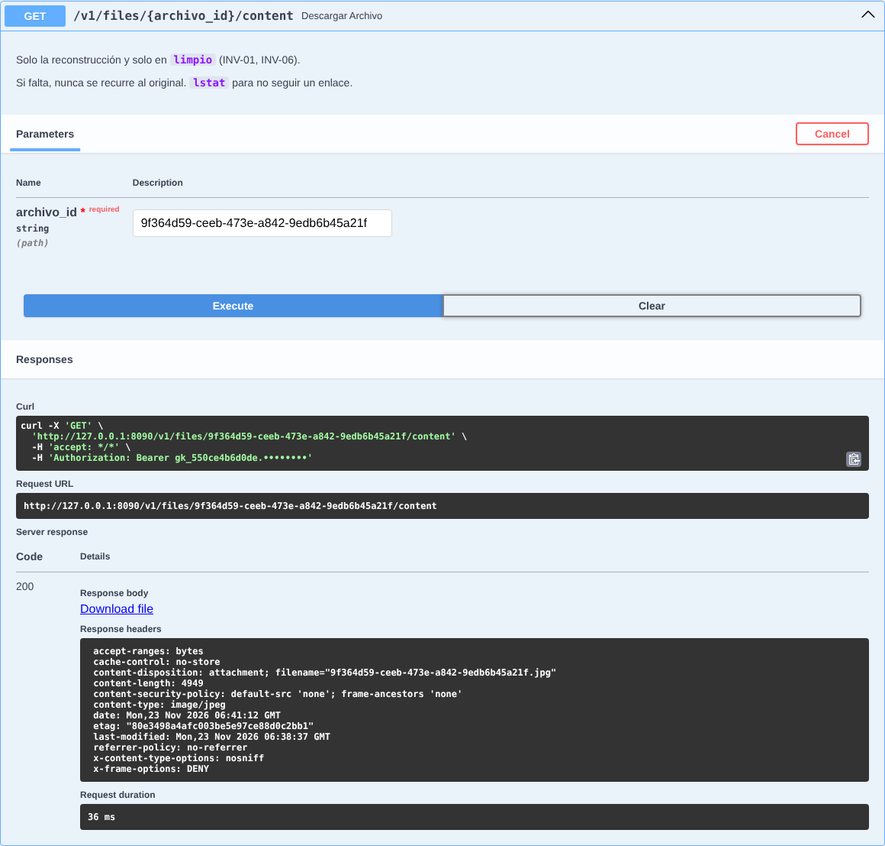

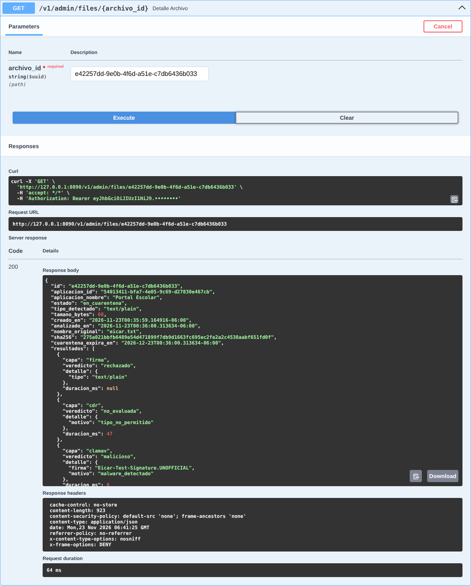

**curl.** `POST /v1/files` lee el cuerpo por *streaming* y no declara `requestBody` en OpenAPI, por lo que Swagger UI no puede adjuntar el archivo. Las subidas y los errores se capturaron con `curl` contra la misma API:

| # | Escenario | Resultado | Captura |
| --- | --- | --- | --- |
| 12 | Subida válida; consulta posterior; sin API key; API key inválida | `202 pendiente` → `200 limpio`; `401`; `401` | [12-curl-subida-202-y-401.png](https://github.com/Rust7730/GateKeeper-API/blob/main/evidencias/12-curl-subida-202-y-401.png) |
| 13 | Archivo de 11 MiB; cuerpo JSON; ejecutable ELF renombrado a `.jpg`; descarga del rechazado | `413`; `415`; `rechazado` con `tipo_detectado: application/x-pie-executable`; `409` | [13-curl-413-415-rechazado-409.png](https://github.com/Rust7730/GateKeeper-API/blob/main/evidencias/13-curl-413-415-rechazado-409.png) |
| 14 | Ráfaga de 40 subidas con la misma API key | 20 × `202` y después `429` con `Retry-After` | [14-curl-rate-limit-429.png](https://github.com/Rust7730/GateKeeper-API/blob/main/evidencias/14-curl-rate-limit-429.png) |
| 15 | Foto con marca, modelo y coordenadas GPS en EXIF; descarga de la copia | La copia ya no tiene EXIF ni GPS y su SHA-256 cambia | [15-curl-cdr-sin-metadatos.png](https://github.com/Rust7730/GateKeeper-API/blob/main/evidencias/15-curl-cdr-sin-metadatos.png) |

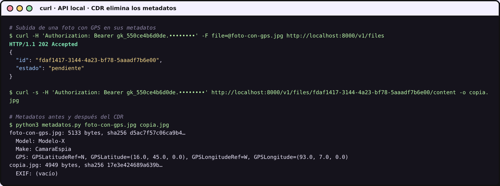

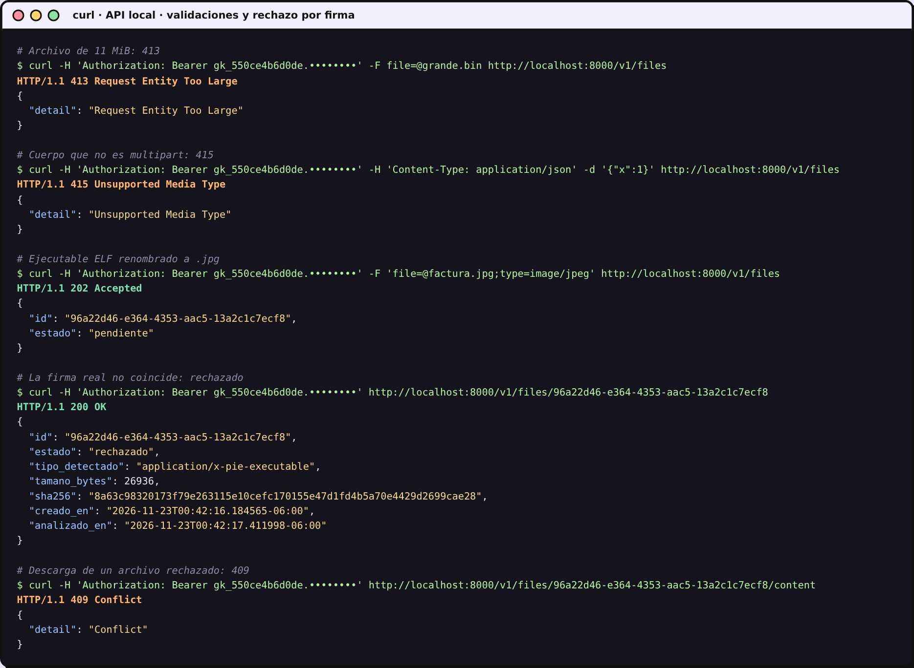

Respuesta real de `GET /v1/admin/files/{id}` para el archivo EICAR (se omiten algunos campos). VirusTotal queda en `no_evaluada` porque en local no hay salida a internet y se agota su presupuesto de 1 s (K07); el veredicto lo decide ClamAV:

```json
{
  "id": "e42257dd-9e0b-4f6d-a51e-c7db6436b033",
  "aplicacion_nombre": "Portal Escolar",
  "estado": "en_cuarentena",
  "tipo_detectado": "text/plain",
  "tamano_bytes": 68,
  "nombre_original": "eicar.txt",
  "cuarentena_expira_en": "2026-12-23T00:36:00.313634-06:00",
  "resultados": [
    { "capa": "firma",  "veredicto": "rechazado",    "detalle": { "tipo": "text/plain" } },
    { "capa": "cdr",    "veredicto": "no_evaluada",  "detalle": { "motivo": "tipo_no_permitido" }, "duracion_ms": 47 },
    { "capa": "clamav", "veredicto": "malicioso",
      "detalle": { "firma": "Eicar-Test-Signature.UNOFFICIAL", "motivo": "malware_detectado" }, "duracion_ms": 6 },
    { "capa": "virustotal", "veredicto": "no_evaluada", "detalle": { "motivo": "presupuesto_vt" }, "duracion_ms": 1000 }
  ]
}
```

#### Pruebas de Seguridad / Análisis (SAST, DAST, Matriz de Ataques y Contenedores)

##### Resumen de resultados de pruebas de seguridad (Fase F6)

| Herramienta / Suite | Alcance Evaluado | Resultado Obtenido |
| --- | --- | --- |
| **Matriz de Ataques (`tests/attack-matrix/`)** | 15 vectores oficiales (`vec:01`–`vec:15`: scripts disfrazados, doble extensión, path traversal, políglotas, PDF JS, PDF cifrado, SVG, ZIP, bomba de píxeles, 500 MB, EICAR, XSS, IDOR, rate limit, descarga pendiente) + 6 vectores extra (`FlateDecode` bomb, datos anexados, RBAC, replay de refresh) | **526 passed, 0 failed, 0 skipped** + **98 passed** en regresión F4/F5/F6 contra PostgreSQL 16, Redis, Landlock y seccomp reales. |
| **SAST — Bandit (`1.9.4`)** | 7,889 líneas de código Python de producción (`api/`, `worker/`, `reputation/`) | **0 High, 0 Medium** (`#nosec`: 0). |
| **DAST — OWASP ZAP (`stable`)** | `zap-api-scan.py` sobre especificación OpenAPI (27 rutas / 84 URLs activas) | **119 PASS, 0 FAIL, 0 High, 0 Medium**, 1 WARN Low informativo (`CORP` en `/health`). |
| **SCA & Contenedores — Trivy (`latest`)** | `uv.lock`, `.venv`, `Dockerfile` e imagen `ghcr.io/rust7730/gatekeeper-api:main` | **0 vulnerabilidades Python**, **0 misconfigs Dockerfile**, **0 secretos**, **0 CVEs HIGH/CRITICAL corregibles**. |
| **Pruebas Frontend (Vitest + Linters)** | Dashboard Angular 22 (`npm run verify`: ESLint, Stylelint, chequeo de seguridad, Vitest, build) | **87/87 pruebas aprobadas**, 0 errores de lint o seguridad. |
| **Auditoría Manual y Remediación** | Revisión profunda de Worker/CDR, Infraestructura y Auth/Admin | **1 Crítico** (`H-01`: symlinks/fuga en cuarentena) y **8 Altos** (`H-02` a `H-09`: permisos, fail-closed ClamAV, endurecimiento ClamAV, aislamiento de pepper, rate-limit/Argon2 async, TOTP anti-replay, enroll 2 fases, Hub SSE dedicado) corregidos y validados. |

##### Evidencia ejecutada para este reporte (23/11/2026)

| Herramienta | Dónde se ejecutó | Resultado | Captura |
| --- | --- | --- | --- |
| Suite completa (`uv run pytest -q`), Ruff, Bandit y firma `cosign` | GitHub Actions, run [44958196290](https://github.com/Rust7730/GateKeeper-API/actions/runs/44958196290) (PR #25), `ubuntu-24.04` con Landlock ABI 8 | **2078 passed, 36 skipped** en 8 min 14 s; Ruff sin errores; Bandit `-ll` sin hallazgos; imagen firmada en `ghcr.io` | [16-ci-pruebas-bandit-firma.png](https://github.com/Rust7730/GateKeeper-API/blob/main/evidencias/16-ci-pruebas-bandit-firma.png) |
| Bandit `-ll` (SAST) | Local, mismo comando que la CI | **0 High, 0 Medium**. Los 1 318 avisos *Low* son en su mayoría `assert` de las pruebas que viven dentro de `api/` | [17-bandit-local.png](https://github.com/Rust7730/GateKeeper-API/blob/main/evidencias/17-bandit-local.png) |
| `pip-audit` (SCA) | Local, sobre las 47 dependencias de producción de `uv.lock` | **No known vulnerabilities found** | [18-pip-audit.png](https://github.com/Rust7730/GateKeeper-API/blob/main/evidencias/18-pip-audit.png) |
| `npm audit` (SCA) | Local, dashboard y landing | Dashboard: **0** en producción y 9 moderadas solo en herramientas de desarrollo (`minimatch` vía ESLint). Landing: 5 avisos en Astro 5 y sus dependencias de compilación; ninguno alcanza al sitio estático publicado (ver la nota) | [17-frontend-npm-audit.png](https://raw.githubusercontent.com/Rust7730/GateKeeper-Frontend/main/docs/evidencias/17-frontend-npm-audit.png) |
| `npm run verify` | Local, dashboard Angular | ESLint, Stylelint, índices y patrones de seguridad sin errores; **87/87 pruebas**; build correcto | [16-frontend-npm-verify.png](https://raw.githubusercontent.com/Rust7730/GateKeeper-Frontend/main/docs/evidencias/16-frontend-npm-verify.png) |
| Pruebas manuales de ataque con `curl` | Local, contra la API | `401`, `404` anti-IDOR, `409`, `413`, `415`, `429`, ELF disfrazado rechazado, EICAR en cuarentena, EXIF/GPS eliminados, TOTP reutilizado rechazado y auditado | capturas 12–15 y 05 |

> **Nota sobre `npm audit` en la landing.** El aviso crítico de Astro afecta a `define:vars` y a los parámetros de *server islands*; la landing no usa ninguno y se compila como sitio estático sin adaptador. Los avisos altos (`sharp`/libvips y `zod`) y el bajo (`esbuild`) solo se ejecutan al compilar o en el servidor de desarrollo. Aun así, actualizar a Astro 7 queda como trabajo pendiente.

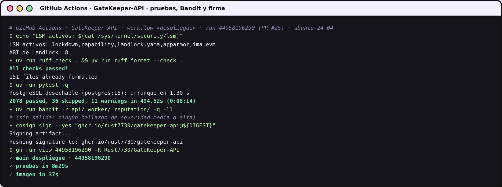

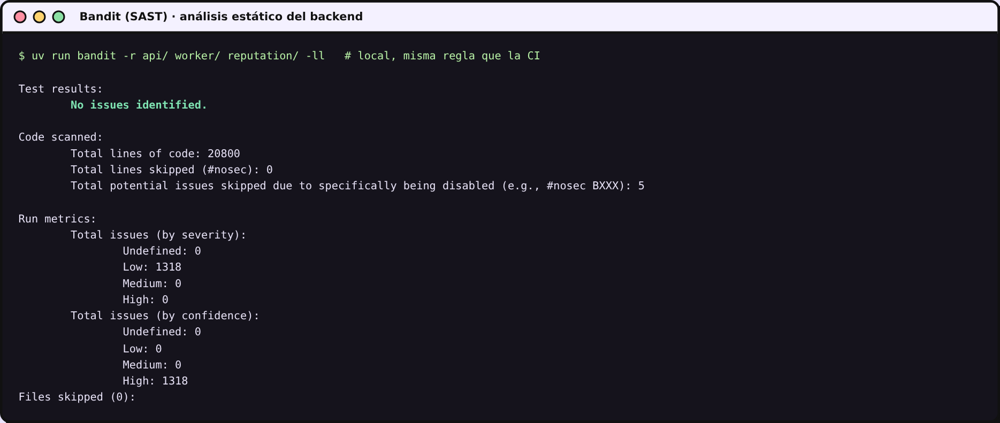

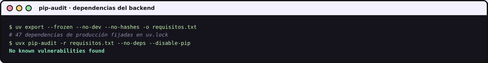


##### Gráficas de resultados de seguridad y auditoría

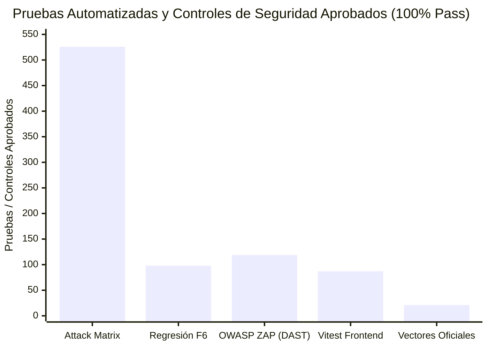

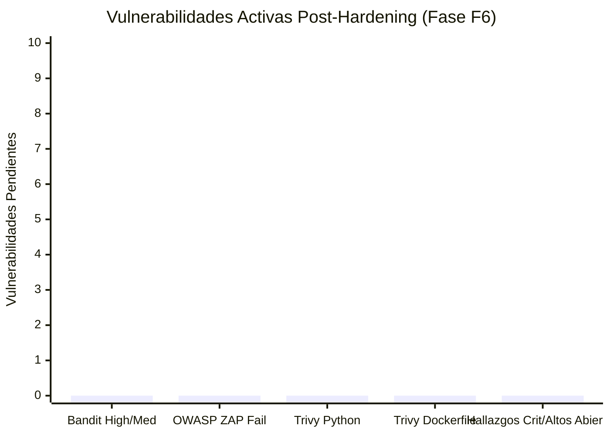

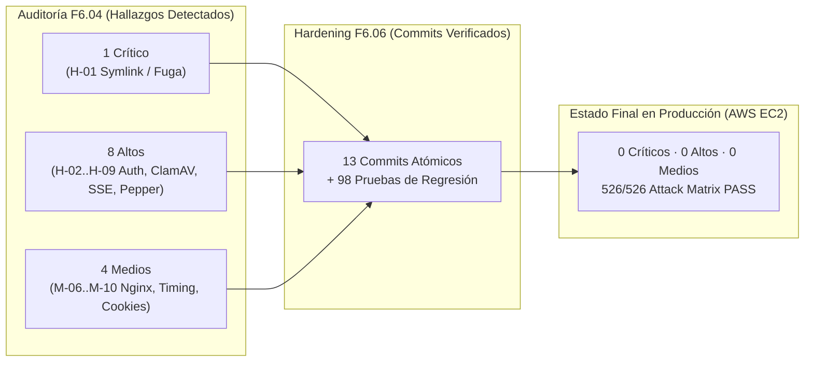

##### Salida de las herramientas


```text
$ pytest tests/attack-matrix/
======================== 526 passed in 118.42s (0:01:58) ========================

$ pytest tests/attack-matrix/test_f6_hardening_auditoria.py
========================= 98 passed in 24.15s =========================

$ bandit -r api worker reputation -ll
Run metrics:
  Total lines of code: 7889
  Total issues (by severity): High: 0, Medium: 0

$ zap-api-scan.py -t http://127.0.0.1:18080/openapi.json -f openapi -T 3
FAIL-NEW: 0    FAIL-INPROG: 0    WARN-NEW: 1    INFO: 0    IGNORE: 0    PASS: 119

$ trivy fs --scanners vuln,secret,misconfig --severity HIGH,CRITICAL --ignore-unfixed .
uv.lock (uv): 0 vulnerabilities
Dockerfile (dockerfile):Tests: 24 (SUCCESSES: 24, FAILURES: 0)
```

---

## Conclusiones y Trabajo Futuro

### Conclusiones

El desarrollo de **Gatekeeper** permitió llevar a producción una arquitectura de seguridad realista y verificable de principio a fin, superando el enfoque tradicional de validación superficial de archivos. Entre los principales aprendizajes y logros técnicos destacan:

- **Defensa en profundidad medible:** La combinación de validación por firma binaria, análisis antimalware (ClamAV + reputación por hash sin fuga de archivos) y desarme/reconstrucción (CDR) dentro de sandboxes de kernel (Landlock + seccomp-bpf) demostró resistir los 21 vectores de ataque evaluados manteniendo latencias competitivas (`p95 < 10 ms` en ingesta `202` y `< 1 s` en veredicto para archivos estándar).
- **Valor de la auditoría integral:** Ejecutar SAST (Bandit), DAST (OWASP ZAP), SCA/contenedores (Trivy) y auditoría manual sobre código propio reveló hallazgos reales de alto impacto (como manejo de *symlinks*, aislamiento de variables de entorno entre redes Docker, *replay* en TOTP y agotamiento de conexiones Redis en SSE) que fueron corregidos y cubiertos con pruebas de regresión permanentes.
- **Operación segura en la nube:** La automatización mediante contenedores inmutables sin privilegios, publicación de artefactos vía GitHub Actions/GHCR y actualización automática por *pull* (`systemd`) permitió operar tanto la infraestructura crítica (API/Dashboard) como la Landing Page aislada sin exponer puertos administrativos ni requerir despliegues manuales propensos a error.

### Trabajo Futuro / Mejoras

1. **Sanitización de imágenes embebidas dentro de PDF (`vecx:pdf_exif_embebido`):** Extender el motor CDR de PDF (`pikepdf`) para extraer, recodificar con Pillow y reinsertar cada *XObject* de imagen embebido dentro de documentos PDF, eliminando también metadatos EXIF internos.
2. **Soporte para formatos ofimáticos (OOXML: `.docx`, `.xlsx`, `.pptx`):** Incorporar un módulo CDR adicional capaz de desarmar macros VBA, vínculos externos y relaciones XML peligrosas en documentos de Office.
3. **Webhooks firmados (HMAC) hacia aplicaciones cliente:** Notificar automáticamente a los sistemas consumidores (como *Lumina*) cuando un archivo pase a `limpio` o `en_cuarentena`, eliminando la necesidad de *polling*.
4. **Dominio corporativo propio y observabilidad centralizada:** Migrar de dominios `sslip.io` a un dominio personalizado con DNSSEC, e integrar exportación de métricas Prometheus/Grafana y alertas SIEM (Slack/PagerDuty) ante picos de archivos infectados o intentos de fuerza bruta.
5. **Actualizar la landing a Astro 7:** cierra los avisos de `npm audit` de la landing, aunque hoy no afecten al sitio estático publicado.
6. **Declarar el cuerpo de `POST /v1/files` en OpenAPI:** la subida lee el cuerpo por *streaming* y no lo declara en la especificación, por lo que Swagger UI no puede adjuntar un archivo; describirlo como `multipart/form-data` sin cambiar cómo se lee permitiría probar la subida desde la documentación interactiva.

---

## Uso y operación

La guía completa para levantar el sistema en local, correr las pruebas, desplegarlo en AWS EC2, actualizarlo, revisar registros y hacer rollback está en [`OPERACION.md`](https://github.com/Rust7730/GateKeeper-API/blob/main/OPERACION.md). La aplicación cliente de demostración tiene su propia guía en [`demo-client-app/README.md`](https://github.com/Rust7730/GateKeeper-API/blob/main/demo-client-app/README.md).

### Subir, consultar y descargar

En otra terminal, con `API_KEY` definida:

```bash
curl -s -H "Authorization: Bearer $API_KEY" -F file=@foto.jpg http://127.0.0.1:8000/v1/files
# {"id":"<uuid>","estado":"pendiente"}

curl -s -H "Authorization: Bearer $API_KEY" http://127.0.0.1:8000/v1/files/<uuid>
# {"id":"<uuid>","estado":"limpio","tipo_detectado":"image/jpeg",...}

curl -s -H "Authorization: Bearer $API_KEY" -o salida.jpg http://127.0.0.1:8000/v1/files/<uuid>/content
```

| Código | Significado |
|---|---|
| `202` | Archivo recibido; el análisis sigue en segundo plano |
| `400` | Multipart inválido, sin parte `file` o archivo vacío |
| `401` | API key ausente, inválida o revocada |
| `404` | El archivo no existe o es de otra aplicación |
| `408` | La subida tardó más de 60 s |
| `409` | El archivo no está `limpio` y no se puede descargar |
| `413` | El archivo supera 10 MiB |
| `415` | La petición no es `multipart/form-data` |
| `429` | Rate limit superado (con `Retry-After` en segundos), o la aplicación ya tiene 20 archivos en análisis (`pendiente`) y se puede reintentar cuando termine alguno |
| `503` | Redis no responde en 1 s o está lleno: el rate limit falla cerrado y la petición no pasa (K60, K61) |
